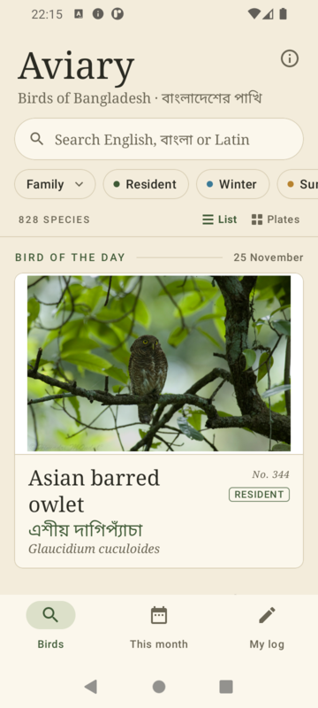
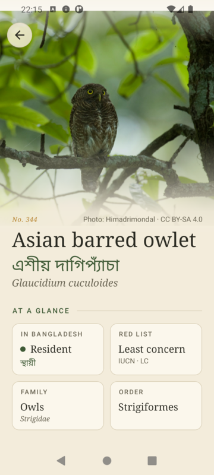
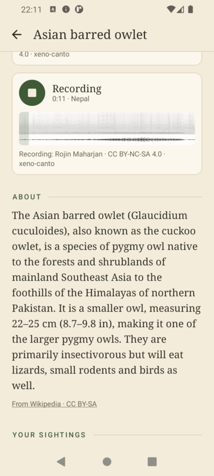
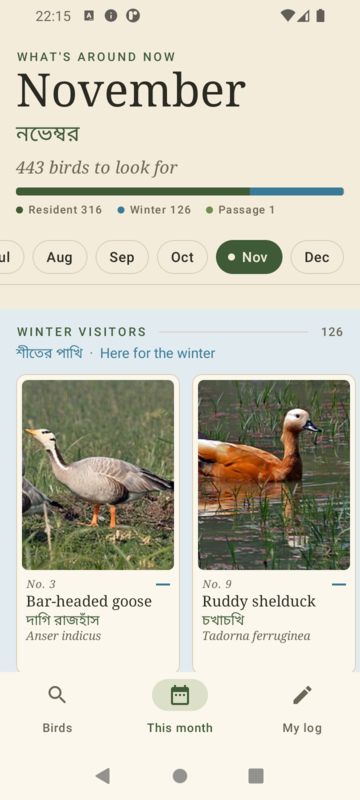
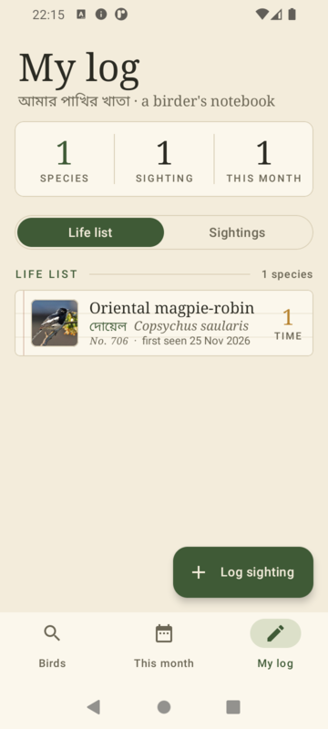

<p align="center"></p>

<h1 align="center">Aviary</h1>
<p align="center"><b>A field guide to the birds of Bangladesh</b> · বাংলাদেশের পাখি</p>

An Android field guide covering all **828 bird species recorded in Bangladesh**. Every species has photos, English, Bangla and scientific names, field notes, and calls and songs. Aviary also tells you what's around this month and keeps a birdwatching log. It's built to work out in the haor with no signal.

| Birds | Bird page | Calls & songs | This month | My log |
|---|---|---|---|---|
|  |  |  |  |  |

## Features

- **All 828 species**, grouped by family. Search English, বাংলা or Latin names, and filter by season, threatened status or family. A different *Bird of the day* every day.
- **Bird pages**:
  - photo plates with credits
  - "At a glance" (status in Bangladesh, IUCN Red List, family)
  - field notes
  - the Wikipedia article in English or বাংলা
  - birds from the same family
- **Calls & songs**: up to three xeno-canto recordings per species, with a sonogram, for 775 species.
- **This month**: which residents and winter or summer visitors to look for in any month.
- **My log**: life list and sightings journal, with count, time, place and optional GPS. It stays on your phone.
- **Offline first**: the whole guide and one photo per species ship inside the app. Full-size photos and calls load when you're online and are cached after that.
- **Bangla names** for 716 species, sourced from the Bangla Wikipedia checklist and the Bangladesh Wildlife Act 2012 schedule.

## Install

Download the APK from [Releases](../../releases) and sideload it. It needs Android 8.0 or newer.

## How it's built

- **`app/`**: Kotlin and Jetpack Compose. No Play Services, no trackers, no ads.
- **`data/`**: a Python pipeline that builds the dataset from open sources:
  - Wikipedia's checklist of Bangladesh birds (Clements taxonomy)
  - Wikidata
  - English and Bangla Wikipedia
  - Wikimedia Commons
  - the xeno-canto API

  It exports `aviary.db` for the app, plus static JSON for a future website. See [data/SCHEMA.md](data/SCHEMA.md).
- **`data/curated/`**: hand-checked corrections, seasons, field notes and Bangla names, each with its source.

```sh
cd data && python build.py --pack                 # rebuild the dataset (cached after the first run)
cd .. && ./gradlew assembleDebug                   # build the app
```

xeno-canto needs a free API key, read from `XC_API_KEY` or `~/.config/aviary/xc_api_key`.

## Corrections welcome

Seasons and field notes for about 450 species are curated, and many are marked medium confidence. If you know Bangladesh's birds and something looks wrong, please open an issue.

## Credits & licences

- **Code:** GPL-3.0 (see [LICENSE](LICENSE)).
- **Text** from Wikipedia contributors: CC BY-SA 4.0.
- **Names, status and links** from Wikidata: CC0.
- **Photos:** Wikimedia Commons photographers. The licence and author are shown on every photo.
- **Recordings:** xeno-canto recordists, mostly CC BY-NC-SA. The recordist is credited on every clip. Species that xeno-canto restricts to protect them from trapping have no recordings.

The icon is a greater racket-tailed drongo (ভীমরাজ).
